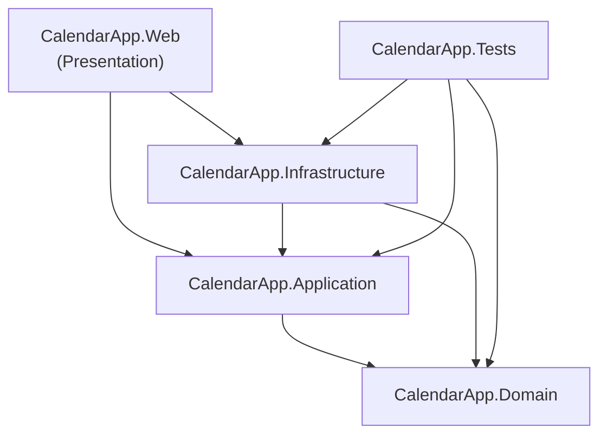
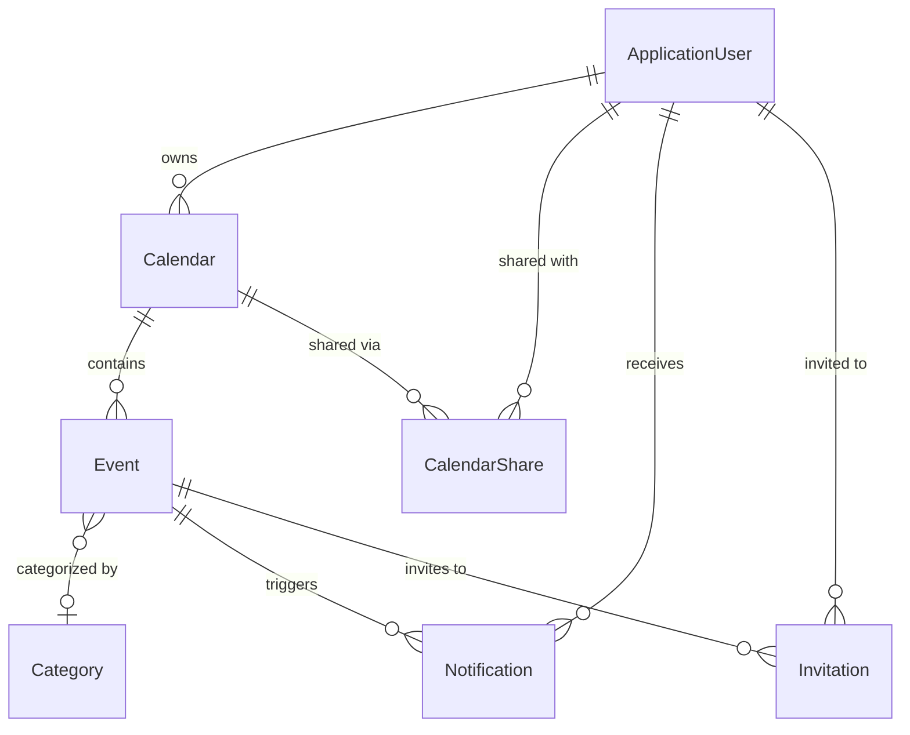

ano# CalendarApp — Architecture & Implementation Plan

> **Project**: Personal Calendar Management System  
> **Technology**: ASP.NET Core 10.x (C#), EF Core, SQLite, Razor Views + Bootstrap, Web API  
> **Author**: Samuel Kouřil  
> **Created**: 2026-10-14

---

## Table of Contents

1. [Functional Requirements](#1-functional-requirements)
2. [Solution Architecture](#2-solution-architecture)
3. [Domain Entities](#3-domain-entities)
4. [Database Design](#4-database-design)
5. [Layer Responsibilities](#5-layer-responsibilities)
6. [User Roles & Authorization](#6-user-roles--authorization)
7. [Admin Area](#7-admin-area)
8. [Web API](#8-web-api)
9. [Validation](#9-validation)
10. [Notifications](#10-notifications)
11. [File Upload](#11-file-upload)
12. [Seeding](#12-seeding)
13. [Bonus Features](#13-bonus-features)
14. [Project Structure](#14-project-structure)
15. [Technology Stack](#15-technology-stack)
16. [Milestones](#16-milestones)

---

## 1. Functional Requirements

### Core Features

| # | Feature | Description |
|---|---------|-------------|
| F1 | User Registration & Login | Users can register, log in, and manage their profile using ASP.NET Core Identity. |
| F2 | Multiple Calendars | Each user can create and manage multiple calendars (e.g., Work, Personal, School). |
| F3 | Event Management (CRUD) | Users can create, read, update, and delete events within their calendars. |
| F4 | Recurring Events | Support for simple recurrence patterns: Daily, Weekly, Monthly, Yearly with optional end date. |
| F5 | Event Categories | Events can be categorized (Meeting, Lecture, Sport, etc.) with color coding. |
| F6 | In-App Notifications | Reminders for upcoming events, displayed as a notification bell in the navbar. |
| F7 | Calendar Sharing | Users can share entire calendars with other users at different access levels (ReadOnly, ReadWrite). |
| F8 | Event Invitations | Users can invite other users to specific events; invitees can accept or decline. |
| F9 | Admin Dashboard | Admin area for full CRUD management of all entities in the system. |
| F10 | Manager Role | Manager can manage calendars, events, and user interactions but cannot change critical settings. |
| F11 | Profile Image Upload | Users can upload a profile picture (avatar). |
| F12 | Web API | REST API endpoints with JWT authentication for future mobile app extension. |
| F13 | Responsive UI | Bootstrap-based responsive design for all pages. |

### Non-Functional Requirements

- Multi-layered architecture (Domain, Application, Infrastructure, Presentation)
- Repository pattern with interfaces
- Code-First database with EF Core migrations
- No raw SQL anywhere in the codebase
- Server-side + client-side validation
- At least 1 custom validation attribute

---

## 2. Solution Architecture

```
CalendarApp.sln
├── src/
│   ├── CalendarApp.Domain          # Entities, Enums, Interfaces (Repository contracts)
│   ├── CalendarApp.Application     # Services, DTOs, ViewModels, Validation Attributes
│   ├── CalendarApp.Infrastructure  # EF Core DbContext, Repositories, Migrations, Seeding
│   └── CalendarApp.Web             # MVC Controllers, Views, API Controllers, wwwroot
└── tests/
    └── CalendarApp.Tests           # Unit tests (xUnit + Moq)
```

### Dependency Flow (references)



> [!IMPORTANT]
> - **Web** references Application (for services) and Infrastructure (only for DI registration/configuration).
> - **Web** NEVER uses Infrastructure types directly in Controllers or Views.
> - **Application** references only Domain (no dependency on Infrastructure or Web).
> - **Infrastructure** references Domain (for entity types) and Application (for service/repository interfaces).

---

## 3. Domain Entities

### 3.1 Entity Overview

| Entity | Description | Min Fields |
|--------|-------------|------------|
| `Event` | A calendar event with title, description, location, start/end time, recurrence | 12+ fields |
| `Calendar` | A named calendar owned by a user, containing events | 5+ fields |
| `Category` | Event category with name and color | 4+ fields |
| `Notification` | In-app notification/reminder for an event | 7+ fields |
| `CalendarShare` | Sharing record linking a calendar to another user with an access level | 6+ fields |
| `Invitation` | Invitation to a specific event for a user, with accept/decline status | 7+ fields |

> **Total custom entities: 6** (does not include Identity entities like `ApplicationUser` or EF internal entities)

### 3.2 Entity Definitions

#### ApplicationUser (extends IdentityUser)

```csharp
public class ApplicationUser : IdentityUser
{
    public string FirstName { get; set; }
    public string LastName { get; set; }
    public string? ProfileImagePath { get; set; }
    public DateTime CreatedAt { get; set; }

    // Navigation properties
    public ICollection<Calendar> Calendars { get; set; }
    public ICollection<CalendarShare> SharedCalendars { get; set; }
    public ICollection<Notification> Notifications { get; set; }
    public ICollection<Invitation> Invitations { get; set; }
}
```

#### Calendar

```csharp
public class Calendar
{
    public int Id { get; set; }
    public string Name { get; set; }           // e.g., "Work", "Personal"
    public string? Description { get; set; }
    public string Color { get; set; }           // Hex color code, e.g., "#3B82F6"
    public DateTime CreatedAt { get; set; }
    public DateTime UpdatedAt { get; set; }

    // Foreign keys
    public string OwnerId { get; set; }
    public ApplicationUser Owner { get; set; }

    // Navigation
    public ICollection<Event> Events { get; set; }
    public ICollection<CalendarShare> Shares { get; set; }
}
```

#### Event

```csharp
public class Event
{
    public int Id { get; set; }
    public string Title { get; set; }
    public string? Description { get; set; }
    public string? Location { get; set; }
    public DateTime StartDate { get; set; }
    public DateTime EndDate { get; set; }       // Validated: must be after StartDate
    public bool IsAllDay { get; set; }
    public RecurrenceType Recurrence { get; set; }  // None, Daily, Weekly, Monthly, Yearly
    public DateTime? RecurrenceEndDate { get; set; }
    public DateTime CreatedAt { get; set; }
    public DateTime UpdatedAt { get; set; }

    // Foreign keys
    public int CalendarId { get; set; }
    public Calendar Calendar { get; set; }
    public int? CategoryId { get; set; }
    public Category? Category { get; set; }

    // Navigation
    public ICollection<Notification> Notifications { get; set; }
    public ICollection<Invitation> Invitations { get; set; }
}
```

#### Category

```csharp
public class Category
{
    public int Id { get; set; }
    public string Name { get; set; }            // e.g., "Meeting", "Lecture", "Sport"
    public string Color { get; set; }           // Hex color, e.g., "#EF4444"
    public string? Icon { get; set; }           // Optional Bootstrap icon class

    // Navigation
    public ICollection<Event> Events { get; set; }
}
```

#### Notification

```csharp
public class Notification
{
    public int Id { get; set; }
    public string Message { get; set; }
    public DateTime CreatedAt { get; set; }
    public DateTime? ReadAt { get; set; }
    public bool IsRead { get; set; }
    public NotificationType Type { get; set; }  // EventReminder, InvitationReceived, CalendarShared
    public DateTime? RemindAt { get; set; }     // When to show the notification

    // Foreign keys
    public string UserId { get; set; }
    public ApplicationUser User { get; set; }
    public int? EventId { get; set; }
    public Event? Event { get; set; }
}
```

#### CalendarShare

```csharp
public class CalendarShare
{
    public int Id { get; set; }
    public ShareAccessLevel AccessLevel { get; set; }  // ReadOnly, ReadWrite
    public DateTime SharedAt { get; set; }
    public bool IsAccepted { get; set; }

    // Foreign keys
    public int CalendarId { get; set; }
    public Calendar Calendar { get; set; }
    public string SharedWithUserId { get; set; }
    public ApplicationUser SharedWithUser { get; set; }
}
```

#### Invitation

```csharp
public class Invitation
{
    public int Id { get; set; }
    public InvitationStatus Status { get; set; }  // Pending, Accepted, Declined
    public DateTime SentAt { get; set; }
    public DateTime? RespondedAt { get; set; }
    public string? Message { get; set; }          // Optional message from inviter

    // Foreign keys
    public int EventId { get; set; }
    public Event Event { get; set; }
    public string InvitedUserId { get; set; }
    public ApplicationUser InvitedUser { get; set; }
    public string InvitedByUserId { get; set; }
}
```

### 3.3 Enums

```csharp
public enum RecurrenceType { None, Daily, Weekly, Monthly, Yearly }
public enum ShareAccessLevel { ReadOnly, ReadWrite }
public enum InvitationStatus { Pending, Accepted, Declined }
public enum NotificationType { EventReminder, InvitationReceived, CalendarShared, InvitationResponse }
```

### 3.4 ViewModels / DTOs (minimum 5 required)

| ViewModel / DTO | Used In | Purpose |
|-----------------|---------|---------|
| `EventCreateViewModel` | MVC Create View | Form data for creating a new event |
| `EventEditViewModel` | MVC Edit View | Form data for editing an event |
| `CalendarDetailViewModel` | MVC Detail View | Calendar with its events for display |
| `DashboardViewModel` | MVC Dashboard | Aggregated data for user's dashboard |
| `EventApiDto` | Web API | JSON-serializable event data for API |
| `CalendarApiDto` | Web API | JSON-serializable calendar data for API |
| `NotificationViewModel` | MVC Navbar | Notification data for the bell dropdown |
| `UserProfileViewModel` | MVC Profile | User profile data with avatar |
| `ShareCalendarViewModel` | MVC Share Dialog | Form for sharing a calendar |
| `InvitationViewModel` | MVC Invitations | Invitation data for accept/decline |

---

## 4. Database Design

### 4.1 ER Diagram



### 4.2 Foreign Key Relationships

| Parent | Child | FK Column | Relationship |
|--------|-------|-----------|-------------|
| `ApplicationUser` | `Calendar` | `OwnerId` | One-to-Many |
| `Calendar` | `Event` | `CalendarId` | One-to-Many |
| `Category` | `Event` | `CategoryId` | One-to-Many (optional) |
| `ApplicationUser` | `Notification` | `UserId` | One-to-Many |
| `Event` | `Notification` | `EventId` | One-to-Many (optional) |
| `Calendar` | `CalendarShare` | `CalendarId` | One-to-Many |
| `ApplicationUser` | `CalendarShare` | `SharedWithUserId` | One-to-Many |
| `Event` | `Invitation` | `EventId` | One-to-Many |
| `ApplicationUser` | `Invitation` | `InvitedUserId` | One-to-Many |

### 4.3 Database Provider

- **SQLite** — zero configuration, file-based (`CalendarApp.db`)
- Connection string in `appsettings.json`
- EF Core provider: `Microsoft.EntityFrameworkCore.Sqlite`

---

## 5. Layer Responsibilities

### 5.1 Domain Layer (`CalendarApp.Domain`)

- **Purpose**: Core business entities, enums, and repository interfaces
- **Contains**:
  - Entity classes (`Event`, `Calendar`, `Category`, `Notification`, `CalendarShare`, `Invitation`)
  - Enums (`RecurrenceType`, `ShareAccessLevel`, `InvitationStatus`, `NotificationType`)
  - Repository interfaces (`IRepository<T>`, `IEventRepository`, `ICalendarRepository`, etc.)
- **Dependencies**: None (innermost layer)

### 5.2 Application Layer (`CalendarApp.Application`)

- **Purpose**: Business logic, service interfaces & implementations, DTOs, ViewModels, validation
- **Contains**:
  - Service interfaces (`IEventService`, `ICalendarService`, `INotificationService`, etc.)
  - Service implementations (`EventService`, `CalendarService`, `NotificationService`, etc.)
  - DTOs and ViewModels
  - Custom validation attributes (`DateAfterAttribute`)
  - Mapping logic (Entity ↔ DTO/ViewModel)
- **Dependencies**: Domain

### 5.3 Infrastructure Layer (`CalendarApp.Infrastructure`)

- **Purpose**: Data access, EF Core, repository implementations, migrations, seeding
- **Contains**:
  - `ApplicationDbContext` (EF Core DbContext)
  - Repository implementations (`EventRepository`, `CalendarRepository`, etc.)
  - Generic repository (`Repository<T>`)
  - EF Core migrations
  - Data seeding (`DbInitializer`)
  - EF Core configurations (Fluent API)
- **Dependencies**: Domain, Application

### 5.4 Presentation Layer (`CalendarApp.Web`)

- **Purpose**: MVC Controllers, Views, API Controllers, static files, DI configuration
- **Contains**:
  - MVC Controllers (`HomeController`, `CalendarController`, `EventController`, etc.)
  - API Controllers (`Api/EventsController`, `Api/CalendarsController`, etc.)
  - Admin Area Controllers (`Admin/UsersController`, `Admin/EventsController`, etc.)
  - Razor Views (`.cshtml`)
  - Static files (`wwwroot/`)
  - `Program.cs` (DI registration, middleware pipeline)
  - Authentication/Authorization configuration
- **Dependencies**: Application, Infrastructure (only for DI registration in `Program.cs`)

> [!WARNING]
> Controllers must ONLY use services from the Application layer. No `DbContext`, no repositories, no Infrastructure types in Controllers!

---

## 6. User Roles & Authorization

### 6.1 Roles

| Role | Access Level | Capabilities |
|------|-------------|-------------|
| **Admin** | Full | Manage all entities, users, roles, system settings. Access to Admin Area. Can view/edit/delete everything. Cannot change user password hashes. |
| **Manager** | Moderate | Manage shared calendars, events, categories. Can view user activity. Cannot manage users, roles, or system settings. |
| **User** | Standard | Create/manage own calendars, events. Share calendars. Accept/decline invitations. View own notifications. Upload profile image. |

### 6.2 Authorization Implementation

- Use `[Authorize(Roles = "Admin")]` for Admin Area
- Use `[Authorize(Roles = "Admin,Manager")]` for management features
- Use `[Authorize]` for authenticated-only features
- Resource-based authorization for calendar/event ownership checks in services

---

## 7. Admin Area

### 7.1 Structure

```
Areas/
  Admin/
    Controllers/
      DashboardController.cs      # Admin dashboard with statistics
      UsersController.cs           # User management (CRUD, except password hash)
      CalendarsController.cs       # All calendars management
      EventsController.cs          # All events management
      CategoriesController.cs      # Category management
      NotificationsController.cs   # Notification management
      CalendarSharesController.cs  # Sharing records management
      InvitationsController.cs     # Invitation management
    Views/
      Dashboard/
        Index.cshtml
      Users/
        Index.cshtml, Details.cshtml, Edit.cshtml, Delete.cshtml
      Calendars/
        Index.cshtml, Details.cshtml, Create.cshtml, Edit.cshtml, Delete.cshtml
      Events/
        Index.cshtml, Details.cshtml, Create.cshtml, Edit.cshtml, Delete.cshtml
      Categories/
        Index.cshtml, Details.cshtml, Create.cshtml, Edit.cshtml, Delete.cshtml
      ... (similar for other entities)
    _ViewStart.cshtml
    _ViewImports.cshtml
```

### 7.2 Admin Constraints

- Admin can view and edit all data
- Admin **cannot** modify user password hashes (field excluded from edit form)
- All Admin views include server-side pagination and search/filter

---

## 8. Web API

### 8.1 API Controllers (in `Controllers/Api/`)

| Endpoint Group | Base Route | Key Endpoints |
|---------------|------------|---------------|
| Auth | `/api/auth` | `POST /login`, `POST /register`, `POST /refresh` |
| Calendars | `/api/calendars` | `GET`, `GET /{id}`, `POST`, `PUT /{id}`, `DELETE /{id}` |
| Events | `/api/events` | `GET`, `GET /{id}`, `POST`, `PUT /{id}`, `DELETE /{id}` |
| Categories | `/api/categories` | `GET`, `GET /{id}` |
| Notifications | `/api/notifications` | `GET`, `POST /{id}/read`, `POST /read-all` |
| Shares | `/api/calendars/{id}/shares` | `GET`, `POST`, `DELETE /{shareId}` |
| Invitations | `/api/invitations` | `GET`, `POST`, `PUT /{id}/respond` |

### 8.2 JWT Authentication

- **NuGet**: `Microsoft.AspNetCore.Authentication.JwtBearer`
- JWT settings in `appsettings.json` (secret, issuer, audience, expiration)
- Dual authentication: Cookies (MVC) + JWT (API)
- API endpoints use `[Authorize(AuthenticationSchemes = JwtBearerDefaults.AuthenticationScheme)]`

---

## 9. Validation

### 9.1 Server-Side Validation

- Data annotations on ViewModels/DTOs (`[Required]`, `[StringLength]`, `[EmailAddress]`, etc.)
- Model state validation in controllers
- Custom validation attribute: **`DateAfterAttribute`**

### 9.2 Custom Validation Attribute — `DateAfterAttribute`

```csharp
/// <summary>
/// Validates that the annotated DateTime property is after another DateTime property.
/// Usage: [DateAfter("StartDate", ErrorMessage = "End date must be after start date.")]
/// </summary>
public class DateAfterAttribute : ValidationAttribute
{
    private readonly string _comparisonProperty;

    public DateAfterAttribute(string comparisonProperty)
    {
        _comparisonProperty = comparisonProperty;
    }

    protected override ValidationResult? IsValid(object? value, ValidationContext validationContext)
    {
        var currentValue = (DateTime?)value;
        var property = validationContext.ObjectType.GetProperty(_comparisonProperty);

        if (property == null)
            throw new ArgumentException($"Property '{_comparisonProperty}' not found.");

        var comparisonValue = (DateTime?)property.GetValue(validationContext.ObjectInstance);

        if (currentValue.HasValue && comparisonValue.HasValue && currentValue <= comparisonValue)
        {
            return new ValidationResult(ErrorMessage ?? $"{validationContext.DisplayName} must be after {_comparisonProperty}.");
        }

        return ValidationResult.Success;
    }
}
```

### 9.3 Client-Side Validation

- jQuery Unobtrusive Validation (included with ASP.NET Core MVC)
- Bootstrap form validation styles

---

## 10. Notifications

### 10.1 In-App Notification System

- Notifications stored in `Notification` table
- Notification bell icon in navbar with unread count badge
- Dropdown list of recent notifications on click
- Full notifications page with mark-as-read functionality
- Types: Event Reminder, Invitation Received, Calendar Shared, Invitation Response

### 10.2 Notification Generation

- **Event Reminder**: Generated based on event's `RemindAt` setting (e.g., 15 min before, 1 hour before)
- **Invitation**: Created when a user is invited to an event
- **Calendar Shared**: Created when a calendar is shared with a user
- **Invitation Response**: Created when an invitee accepts/declines

### 10.3 Implementation

- `INotificationService` in Application layer
- Notifications created by relevant services (e.g., `InvitationService.Create()` also creates a notification)
- Notification count loaded via `ViewComponent` or `_Layout.cshtml` partial

---

## 11. File Upload

### 11.1 Profile Image Upload

- Users can upload a profile image (avatar)
- Stored in `wwwroot/uploads/profiles/{userId}.{ext}`
- Accepted formats: `.jpg`, `.jpeg`, `.png`, `.gif`
- Max file size: 2 MB
- Default avatar placeholder when no image uploaded
- Image path stored in `ApplicationUser.ProfileImagePath`

---

## 12. Seeding

### 12.1 Seed Data

On first run (empty database), the `DbInitializer` will create:

1. **Roles**: Admin, Manager, User
2. **Admin Account**: `admin@calendar.app` / `Admin123!`
3. **Default Categories**: Meeting, Lecture, Sport, Birthday, Holiday, Other
4. **Sample User**: `user@calendar.app` / `User123!` with:
   - 2 calendars (Personal, Work)
   - Several sample events across calendars
5. **Sample Manager**: `manager@calendar.app` / `Manager123!`

---

## 13. Bonus Features

### 13.1 File Upload (Bonus Point) ✅

- Profile image upload as described in [Section 11](#11-file-upload)

### 13.2 Unit Tests (Bonus Point) ✅

- **Project**: `CalendarApp.Tests` (xUnit)
- **NuGet**: `xUnit`, `Moq`, `Microsoft.AspNetCore.Mvc.Testing`
- **Target**: `EventService` and/or `EventsController`
- Tests must include interaction with repository/database through services
- Mock repositories using `Moq`
- Test CRUD operations, validation, authorization logic

Example test areas:
- `EventService.CreateAsync()` — valid event creation
- `EventService.CreateAsync()` — validation failure (end before start)
- `EventService.GetByCalendarIdAsync()` — returns only events for given calendar
- `EventService.DeleteAsync()` — only owner can delete

---

## 14. Project Structure

```
CalendarApp/
├── CalendarApp.sln
├── src/
│   ├── CalendarApp.Domain/
│   │   ├── Entities/
│   │   │   ├── Event.cs
│   │   │   ├── Calendar.cs
│   │   │   ├── Category.cs
│   │   │   ├── Notification.cs
│   │   │   ├── CalendarShare.cs
│   │   │   ├── Invitation.cs
│   │   │   └── ApplicationUser.cs
│   │   ├── Enums/
│   │   │   ├── RecurrenceType.cs
│   │   │   ├── ShareAccessLevel.cs
│   │   │   ├── InvitationStatus.cs
│   │   │   └── NotificationType.cs
│   │   └── Interfaces/
│   │       ├── IRepository.cs          (generic)
│   │       ├── IEventRepository.cs
│   │       ├── ICalendarRepository.cs
│   │       ├── ICategoryRepository.cs
│   │       ├── INotificationRepository.cs
│   │       ├── ICalendarShareRepository.cs
│   │       └── IInvitationRepository.cs
│   │
│   ├── CalendarApp.Application/
│   │   ├── DTOs/
│   │   │   ├── EventApiDto.cs
│   │   │   ├── CalendarApiDto.cs
│   │   │   └── ...
│   │   ├── ViewModels/
│   │   │   ├── EventCreateViewModel.cs
│   │   │   ├── EventEditViewModel.cs
│   │   │   ├── CalendarDetailViewModel.cs
│   │   │   ├── DashboardViewModel.cs
│   │   │   ├── NotificationViewModel.cs
│   │   │   ├── UserProfileViewModel.cs
│   │   │   ├── ShareCalendarViewModel.cs
│   │   │   └── InvitationViewModel.cs
│   │   ├── Services/
│   │   │   ├── Interfaces/
│   │   │   │   ├── IEventService.cs
│   │   │   │   ├── ICalendarService.cs
│   │   │   │   ├── ICategoryService.cs
│   │   │   │   ├── INotificationService.cs
│   │   │   │   ├── ICalendarShareService.cs
│   │   │   │   ├── IInvitationService.cs
│   │   │   │   └── IFileUploadService.cs
│   │   │   └── Implementations/
│   │   │       ├── EventService.cs
│   │   │       ├── CalendarService.cs
│   │   │       ├── CategoryService.cs
│   │   │       ├── NotificationService.cs
│   │   │       ├── CalendarShareService.cs
│   │   │       ├── InvitationService.cs
│   │   │       └── FileUploadService.cs
│   │   └── Validation/
│   │       └── DateAfterAttribute.cs
│   │
│   ├── CalendarApp.Infrastructure/
│   │   ├── Data/
│   │   │   ├── ApplicationDbContext.cs
│   │   │   ├── DbInitializer.cs
│   │   │   └── Configurations/
│   │   │       ├── EventConfiguration.cs
│   │   │       ├── CalendarConfiguration.cs
│   │   │       ├── CategoryConfiguration.cs
│   │   │       ├── NotificationConfiguration.cs
│   │   │       ├── CalendarShareConfiguration.cs
│   │   │       └── InvitationConfiguration.cs
│   │   ├── Repositories/
│   │   │   ├── Repository.cs           (generic implementation)
│   │   │   ├── EventRepository.cs
│   │   │   ├── CalendarRepository.cs
│   │   │   ├── CategoryRepository.cs
│   │   │   ├── NotificationRepository.cs
│   │   │   ├── CalendarShareRepository.cs
│   │   │   └── InvitationRepository.cs
│   │   └── Migrations/
│   │       └── (auto-generated by EF Core)
│   │
│   └── CalendarApp.Web/
│       ├── Program.cs
│       ├── appsettings.json
│       ├── Controllers/
│       │   ├── HomeController.cs
│       │   ├── CalendarController.cs
│       │   ├── EventController.cs
│       │   ├── NotificationController.cs
│       │   ├── InvitationController.cs
│       │   ├── ProfileController.cs
│       │   └── Api/
│       │       ├── AuthApiController.cs
│       │       ├── CalendarsApiController.cs
│       │       ├── EventsApiController.cs
│       │       ├── CategoriesApiController.cs
│       │       ├── NotificationsApiController.cs
│       │       ├── SharesApiController.cs
│       │       └── InvitationsApiController.cs
│       ├── Areas/
│       │   └── Admin/
│       │       ├── Controllers/
│       │       │   ├── DashboardController.cs
│       │       │   ├── UsersController.cs
│       │       │   ├── CalendarsController.cs
│       │       │   ├── EventsController.cs
│       │       │   ├── CategoriesController.cs
│       │       │   ├── NotificationsController.cs
│       │       │   ├── CalendarSharesController.cs
│       │       │   └── InvitationsController.cs
│       │       └── Views/
│       │           ├── Dashboard/
│       │           ├── Users/
│       │           ├── Calendars/
│       │           ├── Events/
│       │           ├── Categories/
│       │           ├── Notifications/
│       │           ├── CalendarShares/
│       │           ├── Invitations/
│       │           ├── _ViewStart.cshtml
│       │           └── _ViewImports.cshtml
│       ├── Views/
│       │   ├── Shared/
│       │   │   ├── _Layout.cshtml
│       │   │   ├── _LoginPartial.cshtml
│       │   │   ├── _NotificationBell.cshtml
│       │   │   ├── _ValidationScriptsPartial.cshtml
│       │   │   └── Error.cshtml
│       │   ├── Home/
│       │   │   ├── Index.cshtml          (Landing / Dashboard)
│       │   │   └── Privacy.cshtml
│       │   ├── Calendar/
│       │   ├── Event/
│       │   ├── Notification/
│       │   ├── Invitation/
│       │   ├── Profile/
│       │   ├── _ViewStart.cshtml
│       │   └── _ViewImports.cshtml
│       └── wwwroot/
│           ├── css/
│           ├── js/
│           ├── lib/              (Bootstrap, jQuery)
│           └── uploads/
│               └── profiles/     (User profile images)
│
└── tests/
    └── CalendarApp.Tests/
        ├── Services/
        │   └── EventServiceTests.cs
        └── Controllers/
            └── EventsControllerTests.cs
```

---

## 15. Technology Stack

| Component | Technology | NuGet Package |
|-----------|-----------|---------------|
| Framework | ASP.NET Core 10.x | — |
| ORM | Entity Framework Core | `Microsoft.EntityFrameworkCore` |
| Database | SQLite | `Microsoft.EntityFrameworkCore.Sqlite` |
| Migrations | EF Core Tools | `Microsoft.EntityFrameworkCore.Tools` |
| Identity | ASP.NET Core Identity | `Microsoft.AspNetCore.Identity.EntityFrameworkCore` |
| JWT | JWT Bearer Auth | `Microsoft.AspNetCore.Authentication.JwtBearer` |
| UI | Razor Views + Bootstrap 5 | (included in default template) |
| Validation | jQuery Unobtrusive Validation | `Microsoft.jQuery.Unobtrusive.Validation` |
| Testing | xUnit | `xunit` |
| Mocking | Moq | `Moq` |
| Design EF Core | EF Core Design | `Microsoft.EntityFrameworkCore.Design` |

---

## 16. Milestones

### Week 7 Checkpoint — Project Proposal & Basic Implementation

- [x] Functional requirements document (this plan)
- [x] Entity/database design (ER diagram, entity definitions)
- [ ] Solution with 4 projects created
- [ ] Domain entities implemented
- [ ] EF Core integration with `ApplicationDbContext`
- [ ] Code-First migrations created and applied
- [ ] Generic `IRepository<T>` + `Repository<T>` implemented
- [ ] Specific repository interfaces defined
- [ ] Basic `Program.cs` with DI registration

### Weeks 8-13 — Full Implementation

- [ ] Identity setup (registration, login, roles)
- [ ] MVC controllers + views for Calendar CRUD
- [ ] MVC controllers + views for Event CRUD
- [ ] Category management
- [ ] Calendar sharing (CalendarShare) functionality
- [ ] Event invitations functionality
- [ ] In-app notification system
- [ ] Admin Area with full CRUD for all entities
- [ ] `DateAfterAttribute` custom validation
- [ ] Client-side validation
- [ ] Profile image upload
- [ ] Data seeding (admin + sample data)
- [ ] Web API controllers with JWT auth
- [ ] Responsive UI with Bootstrap
- [ ] Unit tests

### Week 14 — Defense

- [ ] Final testing and bug fixes
- [ ] Code review and cleanup
- [ ] Verify all project requirements are met
- [ ] Prepare for oral defense (no presentation needed for regular term)

---

> [!TIP]
> **Development order recommendation**: Start with Domain entities → Infrastructure (DbContext, migrations, repositories) → Application (services) → Web (controllers, views) → Admin Area → API → Bonus features. This follows the dependency chain and ensures each layer is solid before building on top of it.
